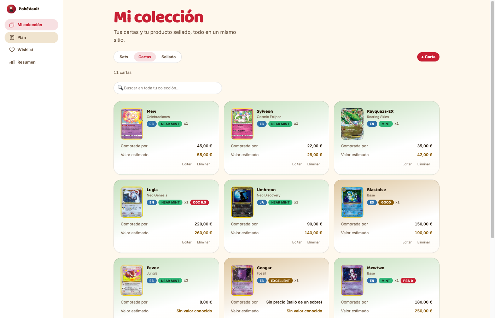
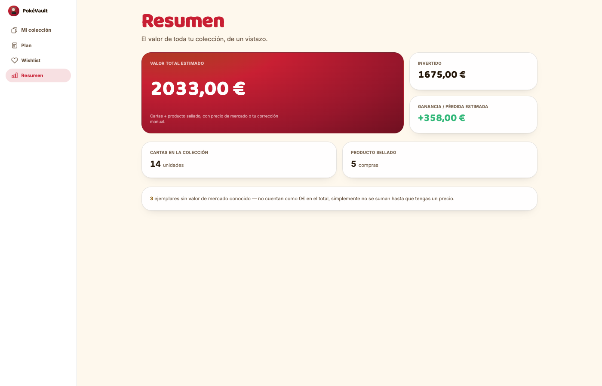
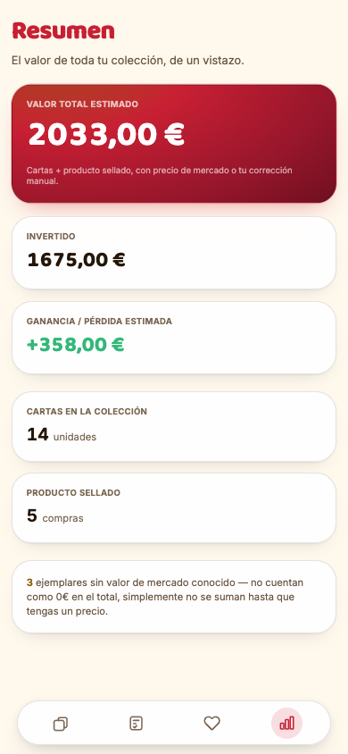
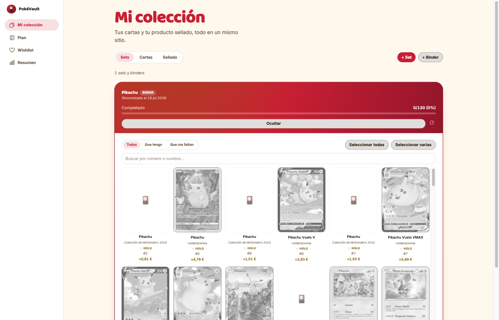

# PokéVault

[](https://github.com/jadueno/pokevault/actions/workflows/ci.yml)

Gestor personal de colecciones de cartas Pokémon TCG: buscas y sincronizas el set que te interesa, marcas de golpe las cartas que ya tienes (con precio de referencia y foto oficial), y queda registrado con precio de compra, valor estimado y plan de compra mensual.

Es una herramienta de uso personal (como sus hermanos [rumbo](../rumbo), [nous](../nous) y [faro](../faro)) construida con calidad de producto real: base de datos real, arquitectura hexagonal, tests de verdad. Multi-usuario real (login, colecciones compartidas) queda para más adelante — ver [ARCHITECTURE.md](ARCHITECTURE.md).

## Capturas

Datos ficticios de ejemplo (sembrados con `npm run seed:demo` contra una base de datos temporal), no la colección real del dueño de la app.

| Mi colección (escritorio) | Resumen (escritorio) | Resumen (móvil) |
| --- | --- | --- |
|  |  |  |

**Binder personalizado** — reúne todas las cartas de un Pokémon (aquí, Pikachu) de cualquier expansión donde haya salido, sin tener que sincronizar cada set entero:



## Configuración inicial (solo la primera vez)

```bash
# 1. Variables de entorno
cp .env.example .env
cp backend/.env.example backend/.env
# Edita ambos .env: tu propia contraseña de Postgres (debe coincidir en los dos archivos,
# tanto en POSTGRES_PASSWORD como dentro de DATABASE_URL), un SESSION_SECRET (p. ej.
# `openssl rand -hex 32`) y unas LOGIN_USERNAME/LOGIN_PASSWORD_HASH (con
# `npm run hash-password -- "tu-contraseña"`, tras el paso 3) para tu primera cuenta.

# 2. Base de datos
docker compose up -d

# 3. Backend
cd backend
npm install
npm run migrate:up
npm run backfill-owner-user  # crea tu cuenta a partir de LOGIN_USERNAME/LOGIN_PASSWORD_HASH
cd ..

# 4. Frontend
npm install
```

## Arrancar en el día a día

```bash
# 1. Base de datos
docker compose up -d

# 2. Backend (puerto 3004)
cd backend && npm run dev

# 3. Frontend (puerto 5186, desde la raíz del proyecto)
npm run dev
```

O directamente `../start-project.sh pokevault` desde `~/AI/proyectos`, que levanta los tres servicios de una vez.

## Tests

```bash
# Backend
cd backend && npm test

# Frontend
npm test

# E2E (Playwright, contra una base de datos de test aparte — nunca la real)
npm run test:e2e
```

## Datos de demostración

Para ver cómo queda la app con contenido (sin darlo de alta a mano uno a uno), contra tu base de datos de desarrollo:

```bash
cd backend
npm run seed:demo        # limpia el demo anterior si lo hay, y siembra de nuevo
npm run seed:demo:clear  # solo lo quita
```

Rellena colección, producto sellado y wishlist con datos ficticios repartidos en varios meses. Cada fila queda marcada con `[DEMO]` al principio de sus notas, así que `seed:demo:clear` solo borra esas filas — nunca toca datos reales que hayas añadido tú. No afecta al Plan (ese ya tiene tu plan real sembrado por migración).

## Checklist de set ("¿qué me falta?")

Desde la pestaña "Sets" de "Mi colección" puedes buscar un set (en español o inglés, p. ej. "Oscuridad Absoluta" o "Pitch Black") y elegirlo de la lista de candidatos que devuelve [TCGdex](https://tcgdex.dev) — nunca se adivina el set a partir de lo que escribes, siempre lo confirmas tú de una lista real. Al añadirlo se descarga su listado completo de cartas (con precio de referencia de Cardmarket cuando el proveedor lo tiene) y queda guardado en tu base de datos. Dentro de un set puedes filtrar (todas / que tienes / que te faltan), buscar por número o nombre, y marcar de golpe varias cartas como tuyas. El precio de referencia se refresca solo una vez por semana (cron en el servidor, ver `ARCHITECTURE.md`) — o al momento si pulsas "🔄 Actualizar" tú mismo.

Una carta marcada como tuya en un set/binder concreto solo cuenta ahí — si la misma carta real está también en otro set/binder que sincronices (p. ej. un binder de un Pokémon que también sale en un set oficial ya sincronizado), no se marca sola en el otro.

## Qué hace la app

- **Mi colección**: todos tus ejemplares, con tu propia estimación de valor y la diferencia frente a lo que pagaste. Buscador propio sobre lo que ya tienes, con orden (nombre, valor, fecha de compra) en la pestaña "Cartas". La pestaña "Sets" es la vía principal para dar de alta cartas (ver más arriba), incluyendo "binders" personalizados con todas las cartas de uno o varios Pokémon de cualquier expansión; para una carta suelta que no pertenezca a ningún set sincronizado, el botón "+ Carta" abre un alta manual (foto opcional solo como imagen adjunta, más un botón para buscarla en el catálogo por nombre/expansión/número) — siempre revisable antes de guardar, nunca alta automática. Si el catálogo confirma una coincidencia, avisa si ya tienes esa carta exacta y, si pertenece a un set/binder ya sincronizado, deja asignarla a él en vez de dejarla suelta.
- **Producto sellado**: sobres, cajas, ETBs — registro de compra con ubicación física y valor estimado a mano.
- **Plan**: tu checklist de compra mes a mes (comprar / guardar sellado), con presupuesto mensual, páginas de compra habituales y notas generales del año. El "hecho" de cada ítem es una casilla de seguimiento independiente — no registra nada en tu colección ni cuenta en el valor total.
- **Wishlist**: deseos puntuales de algo que no tienes todavía, con prioridad, precio máximo y un **mes objetivo de compra** — agrupa la propia wishlist por mes, sin necesitar una pantalla aparte. "Ya la tengo" mueve el deseo a tu colección registrando la compra real.
- **Resumen**: valor total (cartas + sellado), lo invertido, ganancia o pérdida estimada — y un aviso aparte para lo que no tiene valor estimado todavía (nunca se cuenta como 0€ en silencio). También tu carta más valiosa, la distribución por rareza/idioma, y un resumen de cada set/binder sincronizado (% completado y cuánto costaría, a precio de referencia, terminarlo).

## Estructura

- `src/` — frontend (React + Vite + Tailwind).
- `backend/src/domain|application|infrastructure/` — hexagonal: dominio puro, casos de uso, adaptadores (Postgres, TCGdex).
- `backend/src/infrastructure/catalog/` — `tcgdexApiProvider.ts` (real) + `fakePokemonTcgProvider.ts` (tests/E2E).
- `e2e/` — Playwright, contra el proveedor de sets fake (determinista, forzado en `playwright.config.ts` con `POKEMON_TCG_PROVIDER=fake`).

Más detalle de las decisiones técnicas (por qué no hay catálogo externo en vivo, cómo funciona la búsqueda/sincronización de sets, cómo funciona el login) en [ARCHITECTURE.md](ARCHITECTURE.md).

## Privacidad

Multi-usuario real desde el 2026-07-29 (ver ARCHITECTURE.md): cada cuenta tiene sus propios datos, aislados del resto. El login ya es obligatorio siempre — solo `SESSION_SECRET` en `backend/.env` (ver `.env.example`); la primera cuenta se crea con `npm run backfill-owner-user` a partir de `LOGIN_USERNAME`/`LOGIN_PASSWORD_HASH`, sin alta pública todavía.
